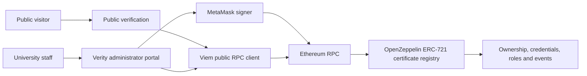
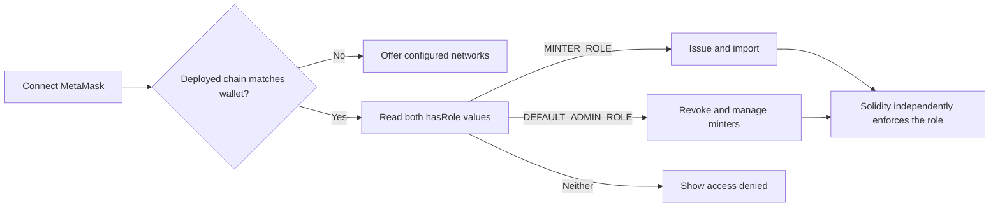
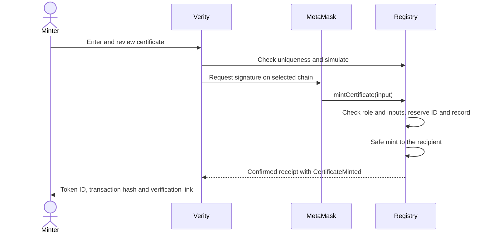
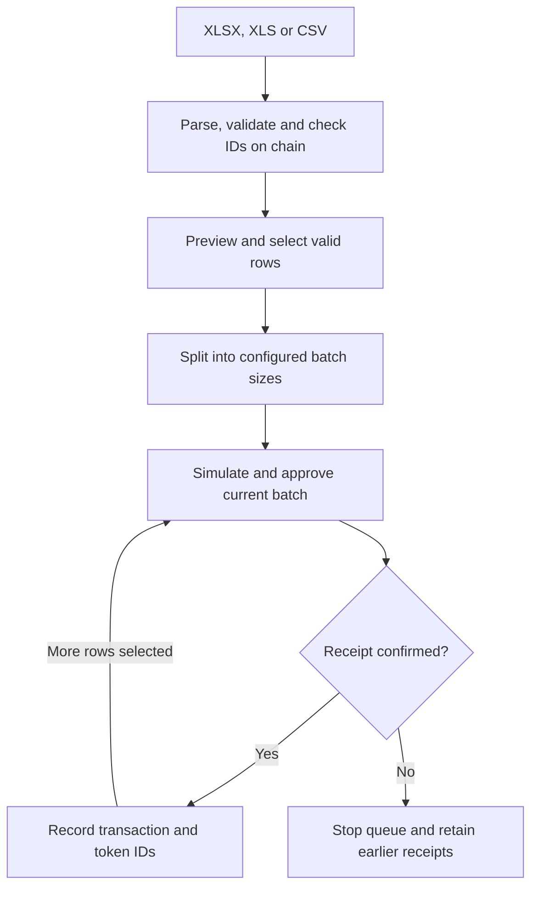
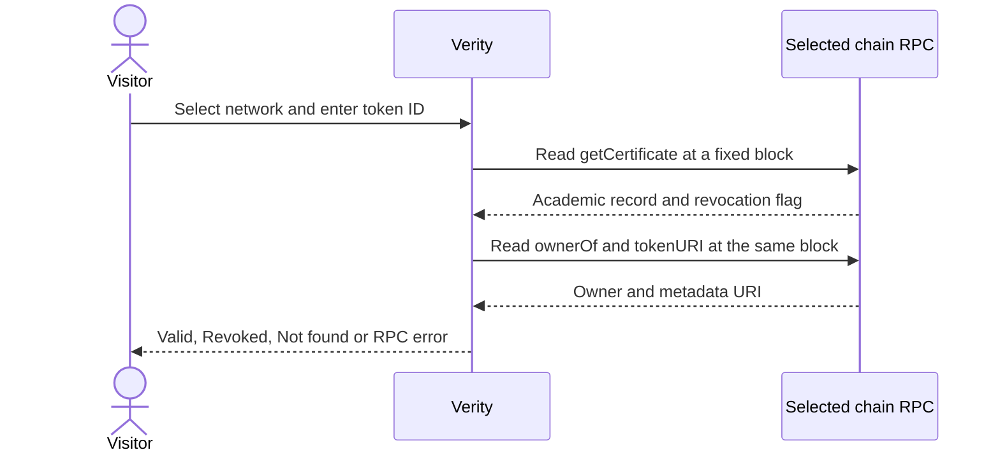
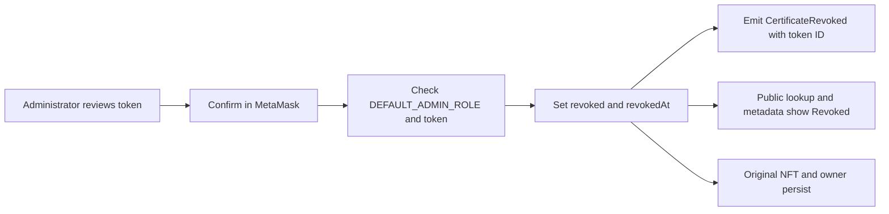

# Architecture

## System

React, wagmi and TanStack Query render chain state. Viem uses a separate deployment manifest for each chain and MetaMask signs writes. Hardhat Local runs the development environment. Sepolia is the public test target.

## Wallet authorization

The constructor grants both roles to an explicit address. `AccessControlEnumerable` supplies the authoritative minter list. Role removal and renunciation both protect the final administrator seat. The UI allows the administrator to grant and remove only the minter role.

## Single mint

## Bulk mint

An array of `CertificateInput` structs replaces the handout's illustrative address and URI arrays. Each struct binds the academic fields to its recipient. Single and batch minting share validation, reservation and safe minting logic. The entire batch reverts if any input or receiver fails.

## Public verification

Links encode the network and ID. The contract encodes JSON as a data URI and derives the status from the same revocation flag exposed by `getCertificate`.

## Revocation

## Evolution from Devoir 1

| Dimension | Devoir 1 | Devoir 2 |
| --- | --- | --- |
| Token identity | Custom certificate ID | Sequential ID shared by the academic record and ERC-721 NFT |
| Recipient | Optional address | Required NFT owner |
| Authorization | Owner and administrator allowlist | Enumerable administrator and minter roles |
| Uniqueness | Student ID and diploma pair, reusable after revocation | Canonical student ID reserved permanently |
| Revocation | Persistent record with revoked flag | Persistent token, ownership, revoked flag and revocation timestamp |
| Metadata | Custom registry read | Dynamic ERC-721 JSON data URI |
| Network | Local Hardhat | Independent Hardhat Local and Sepolia deployment configuration |
| Batch API | Parallel arrays | One array of validated certificate structs |
